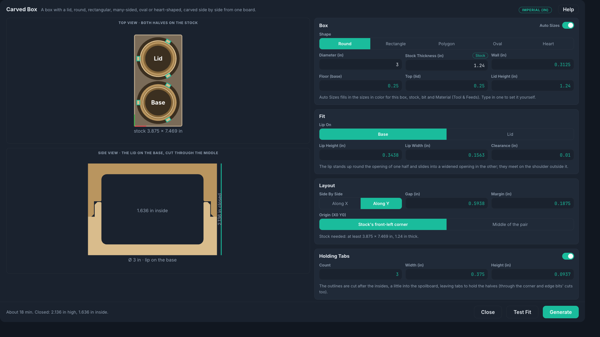
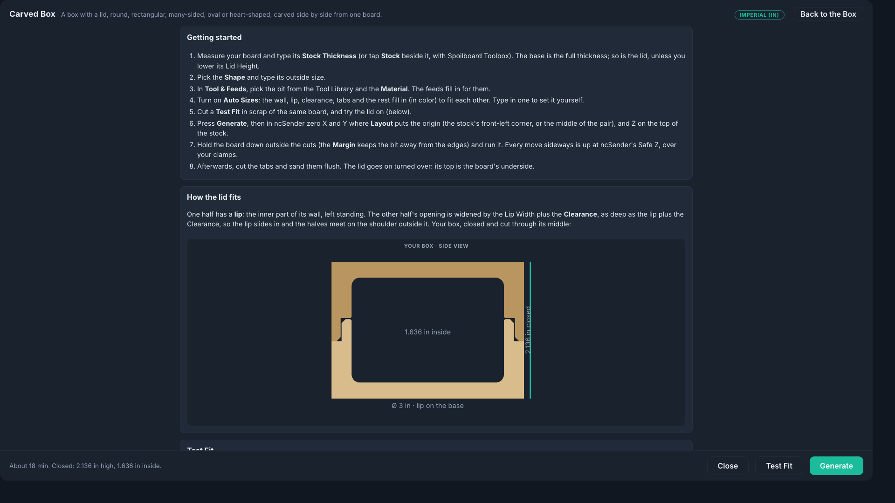
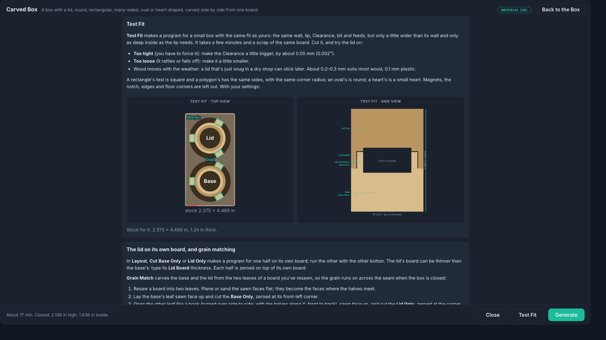

# Carved Box

An [ncSender](https://github.com/siganberg/ncSender) plugin that carves a round, rectangular, many-sided, oval or heart-shaped box with a lid out of one board, or one shaped like your own SVG or DXF drawing. The base and the lid are cut side by side: each is pocketed down to its wall, floor and top, a lip on one half slides into the other with the clearance you set, and both outlines are cut free with holding tabs. One program, with the box's bit, then (when you use them) a ball or bowl bit for rounded floor corners and a V-bit or roundover bit for the edges.

## Getting started

Lid styles: **Carved**, **Solid**, or **Drop-In**, a flat panel flush in a rabbet round the top of a ring glued onto a bottom (both panels from the Floor Board, with Floor Only).

**Guided Setup**, in the Start card, asks five questions about the box and sets it up with Auto Sizes on, then lists the job: the board, the programs in order (by whether ncSender has a tool change set up), and the assembly.

1. For a quick start, pick a preset in the **Start** card (a ring box, a trinket box, a keepsake box with magnets, a hexagon, an oval, a heart, a nested set): it loads right away and sets the box's shape, size and options, keeping your stock, bit and feeds. **Save** your own settings there under a name to load again later, everything included.
1. Measure your board and type its **Stock Thickness** (or tap **Stock** beside it, with Spoilboard Toolbox).
2. Pick the **Shape** and type its outside size.
3. In **Tool & Feeds**, pick the bit from the Tool Library and the **Material**; the feeds fill in.
4. Turn on **Auto Sizes**: the wall, lip, clearance, tabs and the rest fill in to fit each other.
5. Cut a **Test Fit** in scrap of the same board and try the lid on (below).
6. Press **Generate**. In ncSender, zero X and Y where **Layout** puts the origin and Z on the top of the stock, hold the board down outside the cuts, and run it.
7. Cut the tabs and sand them flush. The lid goes on turned over: its top is the board's underside.

**Help** (top right of the dialog) walks through these, how the lid fits, and Test Fit, with pictures drawn from your settings.

## Test Fit

**Test Fit** makes a program for a small box with the same fit as yours: the same wall, lip, Clearance, bit and feeds, only a little wider than its wall and only as deep inside as the lip needs. It takes a few minutes and a scrap of the same board. Cut it and try the lid on: if you have to force it, make the Clearance a little bigger (about 0.05 mm, 0.002"); if it rattles, a little smaller. Wood moves with the weather, so leave a lid that's just snug in a dry shop a touch looser. A rectangle's test is square and a polygon's has the same sides, with the same corner radius; an oval's is round; a heart's is a small heart. Magnets, the notch, edges and floor corners are left out.

## Settings

- **Start:** presets for a first box, and your own saved settings (pick one to load it; Save under a name, Delete).
- **Auto Sizes** (the switch on the Box card, on for a first try): fills in the wall, floor, top, Lid Height (as high as the board allows, so nothing is faced away), lip (its thickness half the wall, or with magnets as thin as leaves their holes room, down to 1/4"; in wood at least 1/4" high when the box is deep enough), clearance (from the Material in Tool & Feeds), gap, margin, tabs, notch, magnet count and edges for the box's size, stock and bit, so they fit each other: with magnets, a notch or edges on, the wall gets thicker (or the notch and edges smaller) until they fit. The sizes it fills are in color; typing in one sets it yourself and turns it off.
- **Box:** the **Shape**: **Round**, with its outside **Diameter**, or **Rectangle**, with its outside **Width (X)**, **Length (Y)** and **Corner Radius** (at least Wall − Lip Thickness − Clearance + half the bit, so the lip's corners fit the opening; the inside corners are tighter by the wall, at least half the bit), or **Polygon**, with its **Sides** (3 to 12), its size **Across Flats** and **Corner Radius**, a flat side to the front so the lid lines up turned over, **Oval**, with its **Width (X)** and **Length (Y)**, or **Heart**, with its size **Across the Lobes**, from its **Point to Top** and its **Point Radius** (the point to the front; rounded at least as much as a rectangle's corners, and its Wall at least Lip Thickness + half the bit, for the lip to fit at the point and the notch). Or **Drawing**: **Open SVG or DXF** and its biggest closed shape is the outline (seen from above, the top of the drawing to the back), stretched to its **Width (X)** and **Length (Y)** (starting at the file's own size when it gives units; **Keep its proportions** makes one follow the other), its outside corners rounded by the **Corner Radius** for the lip, its inside corners as drawn (no sharper than the bit); the lid is cut as its mirror image so it lands on the base, and the drawing is saved with your settings. In a DXF, closed polylines, circles, ellipses and splines are read, and lines and arcs that meet end to end; shapes inside blocks need exploding first. An oval's ends must be as round as a rectangle's corners. An oval's and a heart's walls and pockets are worked out from their outlines to within 0.02 mm; a heart's pocket can come apart into its lobes as it goes in, and each piece is cleared on its own. Then your measured **Stock Thickness** (the base is the full thickness; with [Spoilboard Toolbox](https://github.com/tmuka/ncsender-plugin-spoilboard-toolbox) installed and on, a **Stock** button beside it puts in the stock thickness kept there), the **Wall Thickness**, the **Base Floor**, the **Lid Top**, the **Height** (the box closed) and the **Lid Height**, its share from the top to the seam where the halves meet; the base is the rest (the lip stands above the seam, from the same board). Empty, each is as high as its board allows; lower, that half's area is faced down first (its outline still cut through the stock). **Measure** **Outside** or **Inside**: inside, a round, rectangular or polygon box's sizes are what it holds (the outside two walls more), and the Height its inside, from the floor (or the glued-on floor) to the underside of the top; an oval's, heart's or drawing's size stays its outside. Switching it shows the same box the other way, and the program's header gives both. When the lip's opening would reach the inside of its half, or come within 1 mm of it, the Lip Height is made as deep as that inside, so they're one flat pocket with no step, with a note.
- **Fit:** the **Lid**: **Carved**, hollowed like the base, or **Solid**, its lip left solid, a plug under a flat top that fits the base's opening (quicker, from a thinner board; the lip on the lid). Which half the lip **Stands Up On**, its **Lip Height** and **Lip Thickness** (the inner part of the wall; it follows the Wall, half of it or what magnets, an inset floor or a sloped lip need, until you type one: the chain link beside it links it again), and the **Clearance Each Side**: about 0.2–0.3 mm in wood (it moves with the weather), 0.1 mm in plastic. The other half's opening is widened by the Lip Thickness plus the Clearance and cut the Lip Height deep; the lip stands the Clearance less, so it stops short of the opening's bottom and the halves close tight on the shoulder outside it.
- **Layout:** the halves side by side **Along X** or **Along Y**, the **Gap Between** them and the **Edge Margin** of wood from the stock's edges to the outside of the cuts (the outline's whole width); the origin (X0 Y0) at the stock's **front-left corner** or the **middle of the pair**. Z0 is the top of the stock. The stock needed is shown.
- **Cut** (on the Layout card): **Both, Side by Side** from one board, or **Base Only** or **Lid Only** (or, with a Glued-On Floor, **Floor Only**), one half on its own board (zeroed on its top), the lid's from a **Lid Board** that can be thinner. **Grain Match** (with one half on its own) carves them from the two leaves of a resawn board: cut the base on one leaf, then open the other like a book (turned over side to side; with the halves along Y, front to back) and cut the lid zeroed at the corner that was over the base's front-left (its front-right; along Y, its back-left), so the lid, turned over onto the base the same way, lands where its wood was and the grain runs on across the seam.
- **Nested Set:** 2 to 5 **Boxes**, each inside the one before with the **Nest Gap** all round and over it: smaller by the wall and the gap (a heart or oval a little more, checked all round), lower to fit under the lid, its own Auto Sizes. Cut **the whole set** in one program on one board (the smaller boxes' halves faced down to their heights first), or **one box on its own** from a board as thick as it needs.
- **Holding Tabs:** count, width and height (from the bottom of each half) on each outline.
- **Magnets:** holes of a set diameter (5 mm to start, for 5 mm magnets) and depth facing each other where the halves meet, the same in both, evenly round the wall outside the lip, half a space either side of the front so they miss the finger notch. A rectangle needs an even number, so they line up whichever way the lid turns over. Glue the magnets in with opposite poles up so they pull together. They need a wall at least Lip Thickness + Clearance + the hole + 1.6 mm thick. The holes must be wider than the bit; with a tool changer set up in ncSender, pick a smaller **Magnet Bit** (an end mill, not a drill) from the Tool Library and the program changes to it for the holes after the outlines, with starting feeds for its size in the material.
- **Compartments:** dividers left standing in the base, carved from the same wood. A **Grid** (Rows and Columns; a rectangle's compartments are exact rounded rectangles) or **Wedges** (2 to 12 Sections out from the middle, the first pointing to the back turned by the **Angle**, and an optional round **Middle** compartment). **Divider Thickness**, and **Divider Height** from the floor: empty is full, up to the lip's top with the lip on the base, or the opening's floor under the lid's lip with it on the lid, and below an Inside Rim chamfer. Each compartment must fit the bit; with **Corners** on, each one's floor corners are rounded. Not with a Glued-On Floor (its ring is cut through) or a nested set.
- **Finger Notches:** round scoops of a set width and depth in the base's rim, to lift the lid by: 1 to 4 (2 to start) evenly round, the first at the front (the left side when the halves are along Y) turned by the **Start Angle** (counterclockwise seen from above). Two opposite each other lift a tight lid straight up with both hands; from one it tips and binds. They must miss the magnet holes: turn them if they don't.
- **Glued-On Floor:** quicker for a big box. The base becomes a **ring**: its inside is cut out through, round the wall, with tabs holding the middle, instead of pocketed (about a third less time on a 250 × 180 × 38 mm box). It's glued onto a **bottom**, cut round its outline with its edge cut down by the **Locating Step**, leaving a **plug** the Clearance smaller than the ring's inside, so the ring lines up by itself while the glue sets. On a heart, a drawing or a narrow oval the plug is half the bit smaller still, to clear every curve the bit rounds in the ring. **Floor Board** empty cuts the bottom from the stock beside the ring and the lid; a thinner board (1/4" plywood) is cut on its own with **Cut: Floor Only**. **Oversize** cuts the bottom a little bigger all round, to trim flush with the ring with a router once it's glued. There's no Base Floor and no rounded floor corners in the ring; the lid is cut as before. **Bottom: Inset, from below** hides the joint: the ring's inside is the lid's opening, cut through, with a **rabbet** round it (**Rabbet Width** into the wall, the ring keeping 2 mm outside it) on the face that's up while it's cut. Turned over, the rabbet is underneath, and a flat panel, the rabbet's shape the Clearance smaller, cut from the **Floor Board** with **Cut: Floor Only**, is glued into it from below, up inside it by the **Recess** so the box stands on the ring. The ring's top isn't cut, so the lip goes on the lid; no magnets, finger notches or sloped lip, and the ring's edges are left. Glue the panel in with the ring still rabbet side up, both the way up they were cut, then turn the base over (a drawing's ring is cut mirrored, as its lid is, so both land as drawn). Glue a solid-wood panel only at the middle of the front and back, so it can move. Grain Match isn't for it.
- **Finishing pass** (always on, set by the **Material** in Tool & Feeds): the roughing leaves a little on the walls (the pockets', the widened opening's, the lip's, a glued-on floor's ring's inside) and on the steps' floors (the widened opening's, the shoulder round the lip): 0.3 mm in MDF, softwood and HDPE, 0.25 mm in hardwood, 0.2 mm in acrylic and polycarbonate, 0.15 mm in aluminum, 0.5 mm in foam. After all of a half's roughing, so nothing roughed later tears up a finished edge, the box's bit skims the step floors in one light pass, then goes once round each wall, in laps of up to 3 Depths of Cut (a lap cuts off fibers the floor skim lifts over the wall's edge): **conventional** in wood and foam (with the spindle turning clockwise, the wood on the bit's left; gentler on the fibres, and it left the cleaner walls in a pine test), **climb** in plastics and aluminum (the wood on its right; it shears them cleaner, with less rubbing and melting).
- **Floor Corners:** a ball bit (the corner radius half its diameter) or a bowl bit (a flat end with rounded corners) rounds the corners where each pocket's floor meets its wall. The box's bit leaves the floor that radius short of the walls; the corner bit then goes round the wall down to the floor, its side on the wall. Cut after the outlines, before the edges: after a tool change when the corner bit is picked from the Tool Library and ncSender has a tool changer, else with **Corners Only** (the corner bit in, Z zeroed on the stock top).
- **Enlarge a picture:** click a blank spot on the top or side view (or ⤢ by its title) to see it over the whole window; the mouse wheel zooms at the pointer, two fingers pinch, and zoomed in a drag moves it, or use −, + and Fit. A blank-spot click, × or Esc goes back.
- **Edges:** chamfers (a V-bit, with its angle, diameter and the diameter of its flat tip, which it keeps off the edge; where there's room beside the edge, the bit goes further out and deeper, so the same chamfer is cut higher up its cone, where its edge moves faster and leaves less fuzz in soft wood, except on a heart or drawing) or roundovers (a roundover bit, with its radius and tip diameter), each sized by how far down it goes. **Outside Seam** cuts each half's rim at its outer edge: closed, the two make a groove where the halves meet. **Lead-In** cuts the lip's outer edge and the opening's edge, to ease the lid on. With a V-bit, **Sloped Lip** goes further, in place of the Lead-In: the lip's whole outer side and the opening's wall are cut at the V-bit's angle, the opening that much narrower at its floor, so the gap stays the Clearance all the way down and the lid centers itself as it closes. The V-bit must be wide enough for the slant (a 90° one at least twice the Lip Height across, a 60° one about 1.2 times), and the lip thicker than its slant plus 1 mm at its top; Auto Sizes thickens the lip and lowers it to fit the bit. The box's bit leaves the opening narrower at its floor, so the lid only goes on once the V-bit has cut the slopes; Test Fit cuts them too. A whole sloped lip doesn't grip: the lid drops on and lifts off, so add magnets to hold it. A **Slope Height** slopes only the lip's top that far: below it the lip stays straight and grips at the Clearance, and the opening narrows to match at its floor in steps of up to 0.25 mm cut by the box's bit (a V-bit there would cut into the straight wall above). The lid centers itself as it goes on, then grips. **Inside Rim** cuts each pocket's top edge, the one you see with the box open: the lip's inner edge, and the edge of the step the lip sits on in the other half. That one is down at the step, below the opening's wall, so the bit must clear the wall: a 60° V-bit or a small roundover fits where a 90° one usually doesn't. On the half with the lip, the seam is down at the shoulder, so the bit must clear the lip standing above it: that needs a thicker wall, a smaller seam or a narrower V-bit, and the waste round it is cleared first as far as the bit reaches. Edges go down in passes of the box's Depth of Cut. The outer top and bottom of the closed box lie on the spoilboard, so they can't be reached. The edges are cut last, after the outlines and the floor corners, with each half held by its tabs: keep the tabs on. With a tool changer set up in ncSender (a manual one too) and the edge bit picked from the Tool Library, the program changes to it (M6). Otherwise cut the box, put the edge bit in, zero Z on the stock top (keep X and Y), and run **Edges Only**.
- **Tool & Feeds:** a bit from ncSender's Tool Library (with a tool changer, the program starts with `M6 T`) or a typed size, and starting feeds from the bit, its flutes and the material, as QuickCut's.

The previews are labelled (Wall, Base Floor, Lid Top, Lip Height, Lip Thickness, Clearance, Gap, Margin): tap a label to go to its field, and tap a problem shown under the settings to go to the field it's about. They show both halves on the stock, and the closed box cut through its middle: the lip in the other half's opening, the clearance drawn a little wider to be seen, the closed and inside heights.

## What it cuts

1. A lower half's area, faced down to its Base or Lid Height. Then each half's inside: a ramp down along a small loop in the middle (a circle, or a long box's center line), loops out to the wall, a pass at a time; the widened opening for the lip first on the half without it; the shoulder round the lip (a ramp along its first loop, loops out past the outline) on the half with it; the magnet holes and the finger notch. With compartments, the inside is cleared down to the dividers' top, then each compartment on its own down to the floor.
2. Both outlines, after the insides so the board stays stiff: a helical ramp, through the stock and 0.5 mm into the spoilboard, lifting over each tab on the last passes.
3. The floor corners, with the corner bit, then the edges, with the edge bit: a ramp down along each, a pass at a time.

Every move sideways is at the machine's safe height (ncSender's **Safe Z** setting, else machine Z0), over any clamps; the bit comes down quickly to 1 mm over the stock, then at the plunge rate.

Put the side of the board you want on the outside of the lid face down: the lid's top is the board's underside.

## License

GPL-3.0. The starting feeds are QuickCut's (siganberg/ncsender-plugin-quickcut), copied by `npm run sync-quickcut`.
